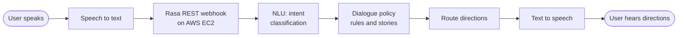

# Voice Navigation Assistant for Visually Impaired Users


A speech-to-speech assistant that gives blind and low-vision users spoken, step-by-step directions inside a building, such as from a conference room to the cafeteria. A Rasa chatbot handles the conversation. A companion mobile app that used the phone's gyroscope and accelerometer is not in this repository.

## How it works



1. The user speaks a request. `Rasa_speech_to_speech.py` captures it from the microphone and converts it to text.
2. The text goes to the Rasa server's REST webhook.
3. Rasa classifies the intent and picks a response using its rules and stories.
4. The reply is read aloud with offline text to speech, so the whole exchange is hands-free and eyes-free.

## What it understands

The domain (`domain.yml`) declares six route intents, each answered with a source and destination:

| From | To |
|---|---|
| Conference room | Cafeteria, gym |
| Cafeteria | Conference room, gym |
| Gym | Conference room, cafeteria |

The NLU training data (`data/nlu.yml`) also has examples for greetings, thanks and further routes such as fifth floor to restroom. Those are not yet declared in the domain, so `domain.yml` needs updating before Rasa will use them.

## Run it locally

```bash
pip install rasa SpeechRecognition pyttsx3 requests
rasa train
rasa run --enable-api
```

In a second terminal, start the voice client:

```bash
python Rasa_speech_to_speech.py
```

The `Dockerfile` and `docker-compose.yml` are early drafts and do not yet produce a working image.

## Deployment

The Rasa server ran on an AWS EC2 instance, and the mobile app connected to it over the instance's address. For a production deployment, put the server behind HTTPS and a domain name rather than a raw IP address.

## Project structure

| Path | Purpose |
|---|---|
| `data/nlu.yml`, `data/rules.yml`, `data/stories.yml` | Training data: intents, rules and conversation flows |
| `domain.yml` | Intents, responses and session configuration |
| `config.yml` | NLU pipeline and dialogue policies |
| `actions/` | Custom action server |
| `Rasa_speech_to_speech.py` | Voice client: speech in, speech out |
| `tests/` | Conversation tests |

## Stack

Python, Rasa (NLU and dialogue management), SpeechRecognition, pyttsx3, AWS EC2.
